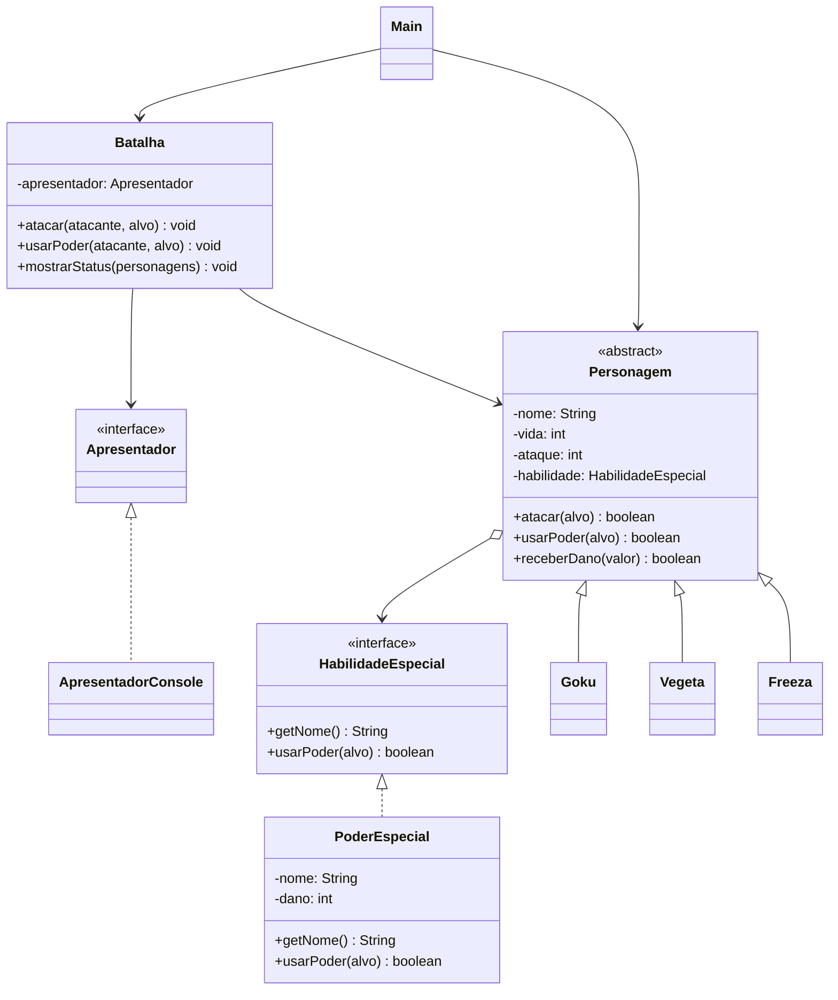

# 🐉 RPG Dragon Ball — Java

## 📌 Sobre o projeto

Este projeto consiste no desenvolvimento de um RPG de batalha inspirado no universo Dragon Ball, utilizando a linguagem Java e os conceitos fundamentais da Programação Orientada a Objetos (POO).

O sistema simula batalhas entre personagens como Goku, Vegeta e Freeza, permitindo realizar ataques básicos e utilizar habilidades especiais que causam diferentes quantidades de dano.

O principal objetivo é aplicar conceitos como classes abstratas, herança, interfaces, polimorfismo e encapsulamento.

## 🎯 Objetivos

- Aplicar os conceitos de Programação Orientada a Objetos.
- Utilizar classes abstratas e herança.
- Implementar interfaces.
- Trabalhar com encapsulamento.
- Aplicar polimorfismo.
- Simular um sistema de batalha entre personagens.

## 🛠️ Tecnologias utilizadas

- **Java:** linguagem utilizada no desenvolvimento.
- **IntelliJ IDEA / VS Code:** ambiente de desenvolvimento.
- **Mermaid:** ferramenta utilizada para criar o diagrama de classes UML.

## 🧩 Estrutura do projeto

O projeto está organizado nas seguintes classes e interfaces:

| Classe / Interface | Responsabilidade |
|---|---|
| `HabilidadeEspecial` | Define o contrato para as habilidades especiais. |
| `PoderEspecial` | Implementa os poderes, armazenando nome e dano. |
| `Personagem` | Classe abstrata que contém os atributos e métodos comuns dos personagens. |
| `Goku` | Representa o personagem Goku. |
| `Vegeta` | Representa o personagem Vegeta. |
| `Freeza` | Representa o personagem Freeza. |
| `Apresentador` | Define os métodos responsáveis pela apresentação das informações. |
| `ApresentadorConsole` | Implementa a exibição das informações no console. |
| `Batalha` | Controla os ataques, poderes e status dos personagens. |
| `Main` | Responsável por iniciar e executar a simulação. |

## 🐲 Personagens

| Personagem | Vida inicial | Ataque básico | Habilidade especial | Dano especial |
|---|---:|---:|---|---:|
| Goku | 100 | 15 | Kamehameha | 30 |
| Vegeta | 100 | 18 | Final Flash | 35 |
| Freeza | 120 | 20 | Raio Mortal | 40 |

## ⚔️ Funcionamento do sistema

O sistema possui dois tipos de ações durante as batalhas:

**1. Ataque básico**

Cada personagem pode realizar um ataque comum contra outro personagem. O dano é definido pelo atributo `ataque`.

**2. Habilidade especial**

Cada personagem possui um poder especial próprio, com nome e quantidade de dano definidos pela classe `PoderEspecial`.

Quando um personagem recebe dano, sua vida é reduzida. Caso ela chegue a zero, o personagem é considerado derrotado.

## 🏗️ Conceitos de POO aplicados

**Encapsulamento**

Os atributos das classes são privados (`private`), permitindo controlar o acesso às informações por meio dos métodos públicos.

**Herança**

As classes `Goku`, `Vegeta` e `Freeza` herdam os atributos e métodos da classe abstrata `Personagem`.

**Abstração**

A classe `Personagem` é abstrata e serve como estrutura principal para os personagens do jogo.

**Interfaces**

São utilizadas duas interfaces:

- `HabilidadeEspecial`: define o comportamento dos poderes especiais.
- `Apresentador`: define os métodos responsáveis por exibir informações.

**Polimorfismo**

O sistema utiliza referências do tipo `Personagem` para trabalhar com diferentes personagens, além de permitir diferentes implementações das interfaces.

## 📊 Diagrama de classes UML

O diagrama abaixo representa a estrutura do projeto, suas classes, interfaces e relacionamentos.

## ▶️ Como executar o projeto

**Pré-requisitos:**

- Java JDK instalado.
- Uma IDE ou editor de código compatível com Java.

**Execução:**

1. Baixe ou clone o repositório.
2. Abra o projeto na sua IDE.
3. Compile os arquivos Java.
4. Execute a classe `Main`.
5. Acompanhe a simulação das batalhas no console.

## 👨‍💻 Autor: Rhamon Soares

Desenvolvido como projeto acadêmico para aplicação dos conceitos de Programação Orientada a Objetos utilizando Java.

**Projeto:** RPG Dragon Ball  
**Linguagem:** Java