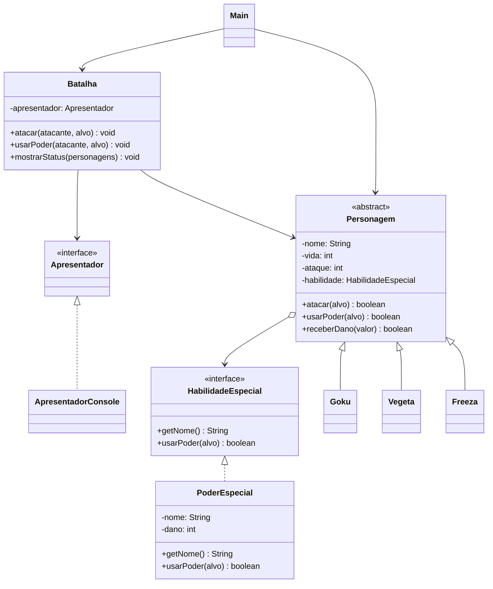

# 🐉 RPG Dragon Ball — Java

## 📌 Sobre o projeto

Este projeto consiste no desenvolvimento de um RPG de batalha inspirado no universo Dragon Ball, utilizando a linguagem Java e os conceitos fundamentais da Programação Orientada a Objetos (POO).

O sistema simula batalhas entre personagens como Goku, Vegeta e Freeza, permitindo realizar ataques básicos e utilizar habilidades especiais que causam diferentes quantidades de dano.

O principal objetivo é aplicar conceitos como classes abstratas, herança, interfaces, polimorfismo e encapsulamento.

## 🎯 Objetivos

- Aplicar os conceitos de Programação Orientada a Objetos.
- Utilizar classes abstratas e herança.
- Implementar interfaces.
- Trabalhar com encapsulamento.
- Aplicar polimorfismo.
- Simular um sistema de batalha entre personagens.

## 🛠️ Tecnologias utilizadas

- **Java:** linguagem utilizada no desenvolvimento.
- **IntelliJ IDEA / VS Code:** ambiente de desenvolvimento.
- **Mermaid:** ferramenta utilizada para criar o diagrama de classes UML.

## 🧩 Estrutura do projeto

O projeto está organizado nas seguintes classes e interfaces:

| Classe / Interface | Responsabilidade |
|---|---|
| `HabilidadeEspecial` | Define o contrato para as habilidades especiais. |
| `PoderEspecial` | Implementa os poderes, armazenando nome e dano. |
| `Personagem` | Classe abstrata que contém os atributos e métodos comuns dos personagens. |
| `Goku` | Representa o personagem Goku. |
| `Vegeta` | Representa o personagem Vegeta. |
| `Freeza` | Representa o personagem Freeza. |
| `Apresentador` | Define os métodos responsáveis pela apresentação das informações. |
| `ApresentadorConsole` | Implementa a exibição das informações no console. |
| `Batalha` | Controla os ataques, poderes e status dos personagens. |
| `Main` | Responsável por iniciar e executar a simulação. |

## 🐲 Personagens

| Personagem | Vida inicial | Ataque básico | Habilidade especial | Dano especial |
|---|---:|---:|---|---:|
| Goku | 100 | 15 | Kamehameha | 30 |
| Vegeta | 100 | 18 | Final Flash | 35 |
| Freeza | 120 | 20 | Raio Mortal | 40 |

## ⚔️ Funcionamento do sistema

O sistema possui dois tipos de ações durante as batalhas:

**1. Ataque básico**

Cada personagem pode realizar um ataque comum contra outro personagem. O dano é definido pelo atributo `ataque`.

**2. Habilidade especial**

Cada personagem possui um poder especial próprio, com nome e quantidade de dano definidos pela classe `PoderEspecial`.

Quando um personagem recebe dano, sua vida é reduzida. Caso ela chegue a zero, o personagem é considerado derrotado.

## 🏗️ Conceitos de POO aplicados

**Encapsulamento**

Os atributos das classes são privados (`private`), permitindo controlar o acesso às informações por meio dos métodos públicos.

**Herança**

As classes `Goku`, `Vegeta` e `Freeza` herdam os atributos e métodos da classe abstrata `Personagem`.

**Abstração**

A classe `Personagem` é abstrata e serve como estrutura principal para os personagens do jogo.

**Interfaces**

São utilizadas duas interfaces:

- `HabilidadeEspecial`: define o comportamento dos poderes especiais.
- `Apresentador`: define os métodos responsáveis por exibir informações.

**Polimorfismo**

O sistema utiliza referências do tipo `Personagem` para trabalhar com diferentes personagens, além de permitir diferentes implementações das interfaces.

## 🧱 Aplicação dos Princípios SOLID

O projeto foi desenvolvido buscando aplicar os cinco princípios SOLID, que são boas práticas da Programação Orientada a Objetos. Esses princípios ajudam a organizar o código, reduzir o acoplamento entre classes e facilitar futuras manutenções e expansões do sistema.

### 1. S — Single Responsibility Principle (Princípio da Responsabilidade Única)

**Uma classe deve possuir apenas uma responsabilidade principal.**

No projeto, cada classe possui uma função específica dentro do sistema:

- `Personagem`: controla os atributos e comportamentos comuns dos personagens, como vida, ataque e recebimento de dano.
- `PoderEspecial`: representa uma habilidade especial, armazenando seu nome e dano.
- `Batalha`: coordena as ações de combate, como ataques, utilização de poderes e exibição de status.
- `ApresentadorConsole`: é responsável por apresentar mensagens e informações no terminal.

**Como foi aplicado:**

A lógica da batalha foi separada da apresentação das informações. Dessa forma, a classe `Batalha` não precisa conhecer os detalhes de como as mensagens são exibidas, pois essa responsabilidade pertence ao apresentador.

Isso facilita a manutenção, pois alterações na apresentação não exigem mudanças na lógica de combate.

### 2. O — Open/Closed Principle (Princípio Aberto/Fechado)

**As classes devem estar abertas para extensão, mas fechadas para modificação.**

O projeto permite adicionar novos personagens sem precisar modificar a estrutura principal da classe `Personagem`.

Por exemplo, para adicionar um novo personagem, basta criar uma classe que herde de `Personagem` e definir seus próprios atributos e habilidade especial.

Exemplo:

```java
class Gohan extends Personagem {
    public Gohan() {
        super("Gohan", 110, 17,
              new PoderEspecial("Masenko", 32));
    }
}
```

**Como foi aplicado:**

A classe abstrata `Personagem` fornece uma estrutura comum, enquanto as classes `Goku`, `Vegeta` e `Freeza` estendem essa estrutura com características próprias.

Assim, novos personagens podem ser adicionados sem alterar a implementação original dos personagens existentes.

### 3. L — Liskov Substitution Principle (Princípio da Substituição de Liskov)

**Uma classe derivada deve poder substituir sua classe base sem comprometer o funcionamento do sistema.**

No projeto, `Goku`, `Vegeta` e `Freeza` herdam de `Personagem`.

Isso permite que qualquer um deles seja utilizado onde o sistema espera receber um objeto do tipo `Personagem`.

Por exemplo:

```java
Personagem goku = new Goku();
Personagem vegeta = new Vegeta();
Personagem freeza = new Freeza();
```

Também é possível armazenar todos em uma mesma lista:

```java
List<Personagem> personagens =
    Arrays.asList(goku, vegeta, freeza);
```

**Como foi aplicado:**

A classe `Batalha` recebe referências do tipo `Personagem` para realizar ataques e utilizar poderes.

Dessa forma, o sistema consegue trabalhar com diferentes personagens sem precisar conhecer especificamente se o objeto é Goku, Vegeta ou Freeza.

### 4. I — Interface Segregation Principle (Princípio da Segregação de Interfaces)

**Uma classe não deve ser obrigada a implementar métodos que não utiliza.**

O projeto utiliza interfaces específicas para separar responsabilidades:

- `HabilidadeEspecial`: define os métodos relacionados aos poderes especiais.
- `Apresentador`: define os métodos responsáveis pela apresentação das informações.

**Como foi aplicado:**

Em vez de criar uma única interface com todos os métodos do sistema, foram criadas interfaces separadas de acordo com suas responsabilidades.

A classe `PoderEspecial` implementa apenas `HabilidadeEspecial`, enquanto `ApresentadorConsole` implementa `Apresentador`.

Isso evita misturar funcionalidades de combate com funcionalidades de apresentação.

### 5. D — Dependency Inversion Principle (Princípio da Inversão de Dependência)

**Módulos de alto nível não devem depender diretamente de módulos de baixo nível. Ambos devem depender de abstrações.**

No projeto, a classe `Batalha` não depende diretamente da implementação concreta `ApresentadorConsole`. Ela depende da interface `Apresentador`.

Observe o construtor:

```java
class Batalha {
    private final Apresentador apresentador;

    public Batalha(Apresentador apresentador) {
        this.apresentador = apresentador;
    }
}
```

E a criação do objeto na classe `Main`:

```java
Batalha batalha =
    new Batalha(new ApresentadorConsole());
```

**Como foi aplicado:**

A classe `Batalha` recebe um objeto que implementa a interface `Apresentador`, sem precisar conhecer sua implementação específica.

Isso permite criar outras formas de apresentação, como um apresentador gráfico, sem precisar modificar a lógica principal da batalha.

### 📌 Conclusão sobre SOLID

A aplicação dos princípios SOLID contribui para uma estrutura mais organizada, flexível e de fácil manutenção.

No RPG Dragon Ball, esses princípios foram utilizados para separar responsabilidades, permitir a extensão de personagens, trabalhar com abstrações e reduzir o acoplamento entre as classes.

Embora existam oportunidades de aprimoramento, a estrutura atual demonstra a aplicação dos conceitos fundamentais de SOLID em um sistema orientado a objetos.


## 📊 Diagrama de classes UML

O diagrama abaixo representa a estrutura do projeto, suas classes, interfaces e relacionamentos.



## ▶️ Como executar o projeto

**Pré-requisitos:**

- Java JDK instalado.
- Uma IDE ou editor de código compatível com Java.

**Execução:**

1. Baixe ou clone o repositório.
2. Abra o projeto na sua IDE.
3. Compile os arquivos Java.
4. Execute a classe `Main`.
5. Acompanhe a simulação das batalhas no console.

## 👨‍💻 Autor: Rhamon Soares

Desenvolvido como projeto acadêmico para aplicação dos conceitos de Programação Orientada a Objetos utilizando Java.

**Projeto:** RPG Dragon Ball  
**Linguagem:** Java